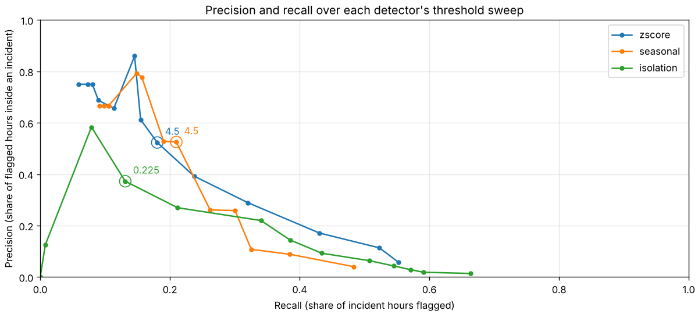
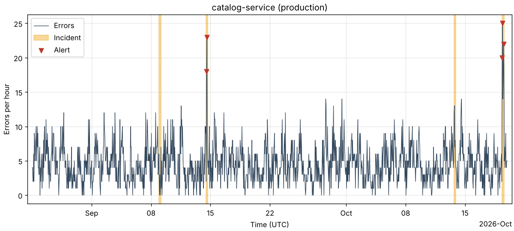
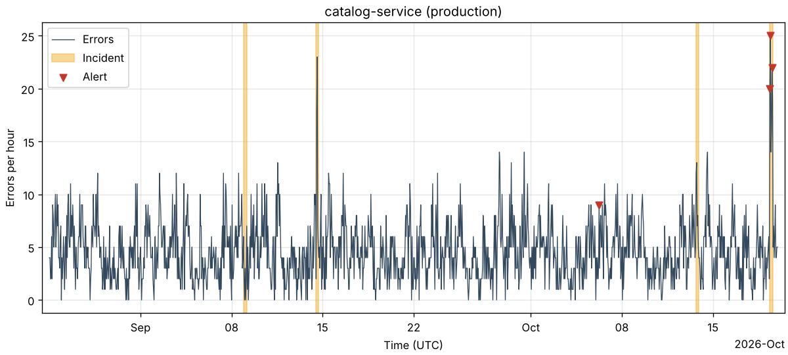
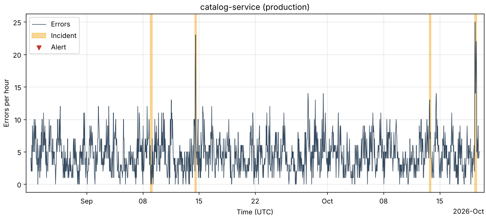

# Evaluation

This file records how well the detectors find the incidents of the simulator. Every number comes from `insights evaluate` and can be reproduced with the command given above its table.

## Method

`insights evaluate` runs the same steps for every seed:

1. Simulate 28 days of traffic ending on 2026-10-20 00:00 UTC (`--days` changes the length).
2. Load the simulation into a temporary DuckDB database.
3. Build one hourly series per application and environment and run the detector on it.
4. Compare the flagged hours with the incident windows in `truth.json`.

The detector never sees `truth.json`. Each simulation has 10 incidents, 3 of them small on purpose (at most 2 hours, at most 6 times the normal rate of the affected failure types).

Results are reported as the mean ± sample standard deviation over seeds 2, 3, 4 and 5. Thresholds are chosen on other seeds (seed 1 for the baseline below, seeds 1, 6, 7, 8 and 9 for the comparison), so the reported numbers never come from the data a threshold was tuned on.

### Metrics

| Metric | Meaning |
|:--|:--|
| Precision | Share of flagged hours that lie inside an incident window of the same series |
| Recall | Share of incident hours that were flagged |
| F1 | Harmonic mean of precision and recall |
| Incident recall | Share of incidents with at least one flagged hour from the incident start up to one hour after its end |
| False alerts/week | Flagged hours outside every incident window (including that extra hour), per week in which the detector has a score |
| Median delay (h) | Median time from the incident start to its first flagged hour, over the detected incidents |

Precision, recall and F1 count the hours of all series together. A ratio with nothing to divide by (for example precision without any flagged hour) is 0. Median delay is averaged only over seeds with at least one detected incident.

## Rolling z-score baseline

```bash
insights evaluate --seeds 2,3,4,5 --detector zscore --threshold 4
```

| Detector | Threshold | Precision | Recall | F1 | Incident recall | False alerts/week | Median delay (h) |
|:--|--:|--:|--:|--:|--:|--:|--:|
| zscore | 4 | 0.55 ± 0.31 | 0.16 ± 0.11 | 0.25 ± 0.16 | 0.25 ± 0.13 | 1.08 ± 0.57 | 1.00 ± 1.08 |

Per seed:

| Seed | Precision | Recall | F1 | Incidents detected | False alerts |
|--:|--:|--:|--:|--:|--:|
| 2 | 0.86 | 0.22 | 0.35 | 4 of 10 | 1 |
| 3 | 0.77 | 0.29 | 0.42 | 3 of 10 | 3 |
| 4 | 0.38 | 0.09 | 0.15 | 2 of 10 | 5 |
| 5 | 0.20 | 0.05 | 0.08 | 1 of 10 | 4 |

The threshold of 4 is the starting value, not a tuned one.

Observations:

- The detector finds only a quarter of the incidents. Two reasons stand out:
  - It needs 168 hours of history before it can score an hour, but the simulator places incidents from hour 24 on. 9 of the 40 incidents start in the first week and cannot be detected.
  - An incident multiplies the rate of a few failure types, while the series counts all errors of an application and environment. A ×15 incident on failure types with 0.2 errors per hour adds only about 3 errors per hour to a series with about 6, which is well inside the normal day-to-night swing.
- The spread between seeds is large: precision ranges from 0.20 to 0.86. With 10 incidents per seed, one detected or missed incident changes incident recall by 0.1, so single-seed numbers are not reliable.
- About one false alert per week is a low burden for an on-call engineer. All 13 false alerts over the four seeds fall between 09:00 and 19:00 UTC, the busy part of the simulated day, which the rolling mean over all hours of the week treats as unusual. 10 of them are in the quieter staging series, where a few extra errors already reach the threshold.

## Seasonal median detector compared with the rolling z-score

The `seasonal` detector compares each hour with the same hour of the week in the 3 previous weeks and the hour on either side (9 values). Expected count = median of those values; spread = MAD × 1.4826, at least `sqrt(expected)` and at least 1; score = `(count - expected) / spread`.

### Period

The seasonal detector needs 3 weeks and 1 hour of history. On 28 days it would have a score only in the last 167 hours, so both detectors are compared on 56 days instead. On 56 days, 1 of the 10 incidents of each seed starts during the warm-up of the z-score detector, and 3 or 4 start during the warm-up of the seasonal detector (14 of the 40 incidents of seeds 2 to 5). Incidents in the warm-up still count as missed.

### Choosing the thresholds

```bash
insights tune --seeds 1,6,7,8,9 --detector zscore --days 56
insights tune --seeds 1,6,7,8,9 --detector seasonal --days 56
```

Each threshold from 2 to 8 in steps of 0.5 is evaluated on the five tuning seeds, and the threshold with the highest mean hour-level F1 is chosen. None of the tuning seeds is used for reporting.

Rolling z-score on seeds 1, 6, 7, 8 and 9:

| Detector | Threshold | Precision | Recall | F1 | Incident recall | False alerts/week | Median delay (h) |
|:--|--:|--:|--:|--:|--:|--:|--:|
| zscore | 2 | 0.02 ± 0.00 | 0.27 ± 0.08 | 0.04 ± 0.01 | 0.42 ± 0.08 | 41.14 ± 1.62 | 0.00 ± 0.00 |
| zscore | 2.5 | 0.04 ± 0.02 | 0.22 ± 0.10 | 0.06 ± 0.03 | 0.38 ± 0.11 | 18.60 ± 2.02 | 0.10 ± 0.22 |
| zscore | 3 | 0.06 ± 0.03 | 0.17 ± 0.09 | 0.09 ± 0.05 | 0.28 ± 0.11 | 9.20 ± 1.85 | 0.20 ± 0.45 |
| zscore | 3.5 | 0.10 ± 0.05 | 0.13 ± 0.07 | 0.11 ± 0.06 | 0.22 ± 0.08 | 3.71 ± 0.87 | 0.20 ± 0.45 |
| zscore | 4 | 0.18 ± 0.06 | 0.13 ± 0.07 | 0.15 ± 0.07 | 0.22 ± 0.08 | 1.74 ± 0.58 | 0.20 ± 0.45 |
| zscore | 4.5 | 0.34 ± 0.21 | 0.10 ± 0.06 | 0.15 ± 0.09 | 0.18 ± 0.11 | 0.54 ± 0.44 | 0.12 ± 0.25 |
| zscore | 5 | 0.51 ± 0.40 | 0.09 ± 0.07 | 0.14 ± 0.11 | 0.14 ± 0.11 | 0.29 ± 0.42 | 0.25 ± 0.50 |
| zscore | 5.5 | 0.47 ± 0.51 | 0.05 ± 0.06 | 0.09 ± 0.11 | 0.08 ± 0.08 | 0.06 ± 0.13 | 0.67 ± 0.58 |
| zscore | 6 | 0.40 ± 0.55 | 0.04 ± 0.07 | 0.07 ± 0.12 | 0.06 ± 0.09 | 0.06 ± 0.13 | 0.50 ± 0.71 |
| zscore | 6.5 | 0.40 ± 0.55 | 0.04 ± 0.07 | 0.07 ± 0.12 | 0.06 ± 0.09 | 0.03 ± 0.06 | 0.50 ± 0.71 |
| zscore | 7 | 0.40 ± 0.55 | 0.04 ± 0.07 | 0.07 ± 0.12 | 0.06 ± 0.09 | 0.03 ± 0.06 | 0.50 ± 0.71 |
| zscore | 7.5 | 0.40 ± 0.55 | 0.04 ± 0.07 | 0.07 ± 0.12 | 0.06 ± 0.09 | 0.03 ± 0.06 | 0.50 ± 0.71 |
| zscore | 8 | 0.40 ± 0.55 | 0.03 ± 0.05 | 0.06 ± 0.08 | 0.06 ± 0.09 | 0.03 ± 0.06 | 0.50 ± 0.71 |

Seasonal median on seeds 1, 6, 7, 8 and 9:

| Detector | Threshold | Precision | Recall | F1 | Incident recall | False alerts/week | Median delay (h) |
|:--|--:|--:|--:|--:|--:|--:|--:|
| seasonal | 2 | 0.01 ± 0.00 | 0.20 ± 0.07 | 0.02 ± 0.01 | 0.34 ± 0.13 | 70.36 ± 2.31 | 0.10 ± 0.22 |
| seasonal | 2.5 | 0.03 ± 0.01 | 0.14 ± 0.07 | 0.05 ± 0.02 | 0.24 ± 0.11 | 22.15 ± 1.69 | 0.10 ± 0.22 |
| seasonal | 3 | 0.04 ± 0.02 | 0.13 ± 0.08 | 0.06 ± 0.03 | 0.24 ± 0.11 | 14.38 ± 1.33 | 0.10 ± 0.22 |
| seasonal | 3.5 | 0.09 ± 0.06 | 0.09 ± 0.08 | 0.09 ± 0.07 | 0.14 ± 0.11 | 4.41 ± 0.99 | 0.12 ± 0.25 |
| seasonal | 4 | 0.10 ± 0.07 | 0.09 ± 0.08 | 0.09 ± 0.07 | 0.14 ± 0.11 | 3.56 ± 0.77 | 0.12 ± 0.25 |
| seasonal | 4.5 | 0.21 ± 0.14 | 0.07 ± 0.08 | 0.10 ± 0.10 | 0.12 ± 0.11 | 1.20 ± 0.51 | 0.25 ± 0.50 |
| seasonal | 5 | 0.23 ± 0.15 | 0.06 ± 0.06 | 0.08 ± 0.08 | 0.10 ± 0.07 | 0.76 ± 0.26 | 0.50 ± 0.58 |
| seasonal | 5.5 | 0.35 ± 0.49 | 0.04 ± 0.07 | 0.06 ± 0.11 | 0.06 ± 0.09 | 0.08 ± 0.11 | 0.50 ± 0.71 |
| seasonal | 6 | 0.35 ± 0.49 | 0.04 ± 0.07 | 0.06 ± 0.11 | 0.06 ± 0.09 | 0.08 ± 0.11 | 0.50 ± 0.71 |
| seasonal | 6.5 | 0.40 ± 0.55 | 0.04 ± 0.07 | 0.07 ± 0.12 | 0.06 ± 0.09 | 0.00 ± 0.00 | 0.50 ± 0.71 |
| seasonal | 7 | 0.40 ± 0.55 | 0.04 ± 0.07 | 0.07 ± 0.12 | 0.06 ± 0.09 | 0.00 ± 0.00 | 0.50 ± 0.71 |
| seasonal | 7.5 | 0.40 ± 0.55 | 0.03 ± 0.05 | 0.05 ± 0.08 | 0.04 ± 0.05 | 0.00 ± 0.00 | 0.50 ± 0.71 |
| seasonal | 8 | 0.40 ± 0.55 | 0.03 ± 0.05 | 0.05 ± 0.08 | 0.04 ± 0.05 | 0.00 ± 0.00 | 0.50 ± 0.71 |

The best mean F1 is at threshold 4.5 for both detectors: 0.10 for `seasonal`, and 0.153 for `zscore`, just above its 0.146 at threshold 4 (both round to 0.15 in the table).

A first attempt tuned on seed 1 alone, as for the baseline. It chose threshold 3 for the seasonal detector, where it raised about 16 false alerts per week on seeds 2 to 5. Seed 1 has only short incidents after the seasonal warm-up, and the seasonal F1 on seed 1 stays at or below 0.04 for every threshold, so a single seed gave almost no evidence. Averaging over five seeds makes the choice much less dependent on one simulation.

### Results on seeds 2 to 5

```bash
insights evaluate --seeds 2,3,4,5 --detector zscore --threshold 4.5 --days 56
insights evaluate --seeds 2,3,4,5 --detector seasonal --threshold 4.5 --days 56
```

| Detector | Threshold | Precision | Recall | F1 | Incident recall | False alerts/week | Median delay (h) |
|:--|--:|--:|--:|--:|--:|--:|--:|
| zscore | 4.5 | 0.52 ± 0.20 | 0.18 ± 0.10 | 0.26 ± 0.13 | 0.30 ± 0.08 | 0.64 ± 0.38 | 0.38 ± 0.48 |
| seasonal | 4.5 | 0.53 ± 0.18 | 0.21 ± 0.12 | 0.29 ± 0.14 | 0.25 ± 0.06 | 1.00 ± 0.37 | 0.50 ± 0.58 |

Per seed:

| Seed | Detector | Precision | Recall | F1 | Incidents detected | False alerts | Monitored hours |
|--:|:--|--:|--:|--:|--:|--:|--:|
| 2 | zscore | 0.78 | 0.26 | 0.39 | 3 of 10 | 2 | 1176 |
| 2 | seasonal | 0.42 | 0.19 | 0.26 | 2 of 10 | 7 | 839 |
| 3 | zscore | 0.53 | 0.26 | 0.35 | 4 of 10 | 8 | 1176 |
| 3 | seasonal | 0.68 | 0.37 | 0.48 | 3 of 10 | 6 | 839 |
| 4 | zscore | 0.29 | 0.06 | 0.10 | 2 of 10 | 5 | 1176 |
| 4 | seasonal | 0.67 | 0.19 | 0.29 | 3 of 10 | 3 | 839 |
| 5 | zscore | 0.50 | 0.14 | 0.22 | 3 of 10 | 3 | 1176 |
| 5 | seasonal | 0.33 | 0.10 | 0.15 | 2 of 10 | 4 | 839 |

Observations:

- The seasonal detector has a slightly higher hour-level F1 (0.29 against 0.26) and recall (0.21 against 0.18) at the same precision, but the difference is well inside the spread between seeds. On this data the two detectors perform about the same.
- Its incident recall is lower (0.25 against 0.30), but most of that is the warm-up: it finds 10 of the 26 incidents it can reach, the z-score detector 12 of the 36 it can reach. Inside the incidents each detector finds, the seasonal detector flags 26 of 39 incident hours, the z-score detector 21 of 35.
- The false alerts differ in kind. 16 of the 18 false alerts of the z-score detector fall between 09:00 and 19:00 UTC, the busy part of the simulated day that the weekly mean treats as unusual. 13 of the 20 false alerts of the seasonal detector fall outside these hours, where a few errors at a usually quiet hour are unusual for that hour. Per week of scored hours the seasonal detector raises 1.0 false alerts, the z-score detector 0.64.
- The z-score detector ignores hours with fewer than 3 errors. The seasonal detector needs no such rule at these thresholds: its spread is at least 1 and its expected count at least 0, so a score of 3 or more already needs at least 3 errors.
- The tests in `tests/test_detection_seasonal.py` show the cases the seasonal detector is built for: on a series with a sharp two-hour daily peak and no incident it flags far fewer hours than the z-score detector at the same threshold, and it catches a spike at a usually quiet hour that the z-score detector misses. The simulated daily cycle is gentler, so this advantage shows only weakly in the numbers above.

## Isolation forest compared with the statistical detectors

The `isolation` detector is a machine-learning model from scikit-learn. It does not compare a count with a baseline directly. It describes every hour with six numbers, learns on the first 14 days of a series what normal hours look like, and then scores the hours after that window.

| Feature | Meaning |
|:--|:--|
| count | Errors in the hour |
| count − expected | Errors minus the median count of the same hour of the day and day type (weekday or weekend) in the training window |
| ratio to the recent mean | count / (mean of the previous 24 hours + 1) |
| hour of the day | Sine and cosine of the hour, so that 23:00 and 00:00 are close |
| weekend | 1 on Saturday and Sunday, otherwise 0 |

The forest has 100 trees and a fixed `random_state` of 0, so the same input gives the same scores. The score is `-decision_function`: the higher it is, the more easily the trees isolate the hour with a few random splits. It is not measured in standard deviations, so its thresholds cannot be compared with the 4.5 of the other detectors. Hours of the training window have no score and never raise an alert, and a score is only an alert when the count is also above the expected count, because the project looks for spikes and an unusually quiet hour would otherwise count as a false alert.

### Period and thresholds

The comparison uses 56 days again. The detector scores the last 42 days (1008 hours per series), and 9 of the 40 incidents of seeds 2 to 5 start inside its training window, so 31 can be reached. The sweep is 0 to 0.3 in steps of 0.025 because the score lives on a different scale. Tuning follows the same protocol as before:

```bash
insights tune --seeds 1,6,7,8,9 --detector isolation --days 56
```

| Detector | Threshold | Precision | Recall | F1 | Incident recall | False alerts/week | Median delay (h) |
|:--|--:|--:|--:|--:|--:|--:|--:|
| isolation | 0 | 0.01 ± 0.00 | 0.46 ± 0.13 | 0.01 ± 0.00 | 0.62 ± 0.08 | 248.37 ± 11.24 | 0.00 ± 0.00 |
| isolation | 0.025 | 0.01 ± 0.00 | 0.38 ± 0.11 | 0.02 ± 0.00 | 0.58 ± 0.13 | 163.73 ± 5.36 | 0.00 ± 0.00 |
| isolation | 0.05 | 0.01 ± 0.00 | 0.32 ± 0.10 | 0.02 ± 0.00 | 0.54 ± 0.15 | 102.00 ± 6.47 | 0.00 ± 0.00 |
| isolation | 0.075 | 0.02 ± 0.00 | 0.28 ± 0.11 | 0.03 ± 0.01 | 0.44 ± 0.15 | 60.80 ± 4.90 | 0.00 ± 0.00 |
| isolation | 0.1 | 0.02 ± 0.01 | 0.23 ± 0.10 | 0.04 ± 0.02 | 0.38 ± 0.13 | 37.13 ± 3.20 | 0.10 ± 0.22 |
| isolation | 0.125 | 0.04 ± 0.02 | 0.22 ± 0.11 | 0.06 ± 0.03 | 0.34 ± 0.15 | 21.57 ± 1.77 | 0.10 ± 0.22 |
| isolation | 0.15 | 0.05 ± 0.02 | 0.18 ± 0.09 | 0.08 ± 0.04 | 0.28 ± 0.13 | 12.77 ± 1.77 | 0.10 ± 0.22 |
| isolation | 0.175 | 0.07 ± 0.03 | 0.15 ± 0.07 | 0.09 ± 0.04 | 0.24 ± 0.11 | 7.87 ± 1.77 | 0.10 ± 0.22 |
| isolation | 0.2 | 0.13 ± 0.14 | 0.10 ± 0.06 | 0.11 ± 0.07 | 0.16 ± 0.05 | 3.47 ± 2.24 | 0.40 ± 0.42 |
| isolation | 0.225 | 0.27 ± 0.16 | 0.08 ± 0.04 | 0.11 ± 0.05 | 0.12 ± 0.04 | 1.43 ± 1.60 | 0.50 ± 0.50 |
| isolation | 0.25 | 0.20 ± 0.45 | 0.01 ± 0.02 | 0.02 ± 0.04 | 0.02 ± 0.04 | 0.13 ± 0.22 | 0.00 ± 0.00 |
| isolation | 0.275 | 0.00 ± 0.00 | 0.00 ± 0.00 | 0.00 ± 0.00 | 0.00 ± 0.00 | 0.00 ± 0.00 | n/a |
| isolation | 0.3 | 0.00 ± 0.00 | 0.00 ± 0.00 | 0.00 ± 0.00 | 0.00 ± 0.00 | 0.00 ± 0.00 | n/a |

The best mean F1 is at threshold 0.225 (0.107 on the tuning seeds, just above 0.105 at 0.2; both round to 0.11 in the table). The scores never exceed about 0.26 on these seeds, so every threshold above 0.25 flags almost nothing.

### Results on seeds 2 to 5

```bash
insights evaluate --seeds 2,3,4,5 --detector isolation --threshold 0.225 --days 56
```

Three-way comparison on the same four report seeds and the same 56 days (the first two rows are the results from above):

| Detector | Threshold | Precision | Recall | F1 | Incident recall | False alerts/week | Median delay (h) |
|:--|--:|--:|--:|--:|--:|--:|--:|
| zscore | 4.5 | 0.52 ± 0.20 | 0.18 ± 0.10 | 0.26 ± 0.13 | 0.30 ± 0.08 | 0.64 ± 0.38 | 0.38 ± 0.48 |
| seasonal | 4.5 | 0.53 ± 0.18 | 0.21 ± 0.12 | 0.29 ± 0.14 | 0.25 ± 0.06 | 1.00 ± 0.37 | 0.50 ± 0.58 |
| isolation | 0.225 | 0.37 ± 0.38 | 0.13 ± 0.16 | 0.19 ± 0.23 | 0.15 ± 0.10 | 0.79 ± 0.50 | 0.25 ± 0.50 |

Per seed for the isolation forest:

| Seed | Precision | Recall | F1 | Incidents detected | False alerts | Monitored hours |
|--:|--:|--:|--:|--:|--:|--:|
| 2 | 0.25 | 0.07 | 0.11 | 1 of 10 | 6 | 1008 |
| 3 | 0.93 | 0.37 | 0.53 | 3 of 10 | 1 | 1008 |
| 4 | 0.11 | 0.03 | 0.05 | 1 of 10 | 8 | 1008 |
| 5 | 0.20 | 0.05 | 0.08 | 1 of 10 | 4 | 1008 |

Observations:

- The isolation forest is the weakest of the three on these seeds: lower precision, lower recall, lower incident recall (6 of the 31 incidents it can reach, 15% of all 40). Its F1 is the best of the three on seed 3 (0.53), and the worst on the other three, and its standard deviation (0.23) is larger than its mean difference to the other detectors, so the ranking is not firm either.
- It flags 17 of the 90 incident hours it can score. Of its 19 false alerts, 15 are in the quiet staging series and 15 fall between 09:00 and 19:00 UTC, the same busy hours that cause most false alerts of the z-score detector.
- The score does not grow with the size of a spike. In the tests a count of 120 and a count of 400 at a quiet hour get the same score, because both lie outside everything the trees saw in training and are isolated by the first split. A statistical score keeps growing, so a ×15 incident stands out further from a ×3 incident. On the plotted series (`series-alerts-isolation.png`) the incident of 19 October has scores between 0.15 and 0.22, all under the threshold of 0.225, although its peak of 25 errors is the highest count of the series.
- The training window is 14 days and holds only 312 usable hours per series (the first 24 are needed for the rolling mean). Incidents inside it are not removed, so the model is partly taught that spikes are normal.

### Which detector is the default

`zscore` stays the default detector (`--detector zscore`). The reasons, in this order:

1. **Simplicity and explainability.** A z-score alert can be explained in one sentence: "this hour had 9 errors where the last week averaged 4.1 with a standard deviation of 1.8". The isolation forest has no such sentence. Its score is a path length averaged over 100 random trees, and the threshold has no unit.
2. **Warm-up.** The z-score detector needs 1 week of history, the seasonal detector 3 weeks and 1 hour, the isolation forest 2 weeks of training. A shorter wait means more of a new application's history can be monitored.
3. **Results.** The z-score detector has the best incident recall (0.30) and the lowest false alert rate (0.64 per week). The seasonal detector has a slightly higher F1 (0.29 against 0.26), a difference far inside the spread between seeds. The isolation forest is not better on any column except the median delay, which is based on very few detected incidents.
4. **Cost.** Scoring one 56-day series takes about 0.5 ms for the z-score detector and 0.25 ms for the seasonal detector, and about 85 ms for the isolation forest, which fits a new model for every series (timings from one run on one machine, so only the ratio matters). It also needs scikit-learn as a dependency.

The seasonal detector remains the better choice where the daily cycle is strong and sharp. The isolation forest would be worth trying again with more features, such as counts of neighbouring series, which a one-dimensional detector cannot use. On the single hourly count of one series, the simple statistics are enough and easier to defend.

## Plots

```bash
insights evaluate --seeds 2,3,4,5 --detector zscore --threshold 4.5 --days 56 --plots docs/img
insights evaluate --seeds 2,3,4,5 --detector seasonal --threshold 4.5 --days 56 --plots docs/img
insights evaluate --seeds 2,3,4,5 --detector isolation --threshold 0.225 --days 56 --plots docs/img
```

Each run writes two files into the folder: `series-alerts-<detector>.png` and `precision-recall.png`. Every run writes the same `precision-recall.png` again, because that plot always holds the curves of all three detectors over their own threshold sweeps (2 to 8 for the statistical detectors, 0 to 0.3 for the isolation forest), drawn from the mean precision and recall over the seeds given, with the chosen thresholds circled (`CHOSEN_THRESHOLDS` in `cli.py`, taken from the tuning above). The series plot shows the series with the most incidents of the first seed (seed 2: `catalog-service` in `production`) with the flags of the detector that was run, at the threshold given.









In this series 4 incidents are drawn. The z-score detector flags the incident of 14 September with 2 hours and the one of 19 October with 3 hours, and nothing else. The seasonal detector cannot score the 14 September incident, which lies in its 3-week warm-up; it flags the 19 October incident with 3 hours and raises one false alert on 6 October. The two incidents of 9 September and 13 October stay below the threshold for both detectors. The isolation forest flags nothing in this series: the scores of the 14 September incident are 0.20 and 0.20, and those of the 19 October incident reach 0.22, all under the threshold of 0.225.

[statistics.md](statistics.md) explains the scores, the variance-to-mean ratio of the simulated counts and how to read the precision and recall curve.
