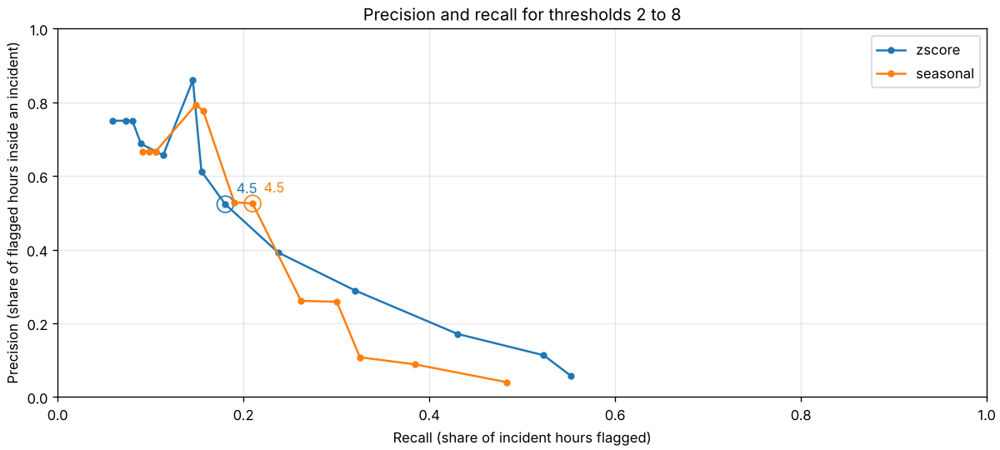
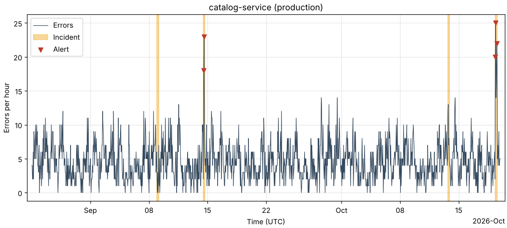

# Statistics behind the detectors

This page explains the statistics that the detectors and the evaluation rely on, in plain words, with the numbers measured on the simulated data. The results of the detectors themselves are in [evaluation.md](evaluation.md).

## Error counts per hour

A detector for error spikes looks at one number per hour: how many errors an application raised in an environment. The simplest model for such a count is the Poisson distribution. If errors arrive independently of each other at an average rate of $\lambda$ per hour, the chance of seeing exactly $k$ errors in an hour is

$$P(K = k) = \frac{\lambda^k e^{-\lambda}}{k!}$$

The one property that matters most here is that the mean and the variance are both $\lambda$. The typical size of a deviation from the mean is therefore $\sqrt{\lambda}$: an hour with 100 expected errors can easily show 110, but an hour with 4 expected errors showing 8 is already unusual. A good detector must expect bigger absolute swings at busy hours than at quiet hours.

### Over-dispersion

Real error counts are often more variable than Poisson counts. Errors come in bursts (one failing dependency makes many requests fail, and clients retry), so the variance is larger than the mean. This is called over-dispersion, and its simplest measure is the variance-to-mean ratio. A ratio near 1 fits the Poisson model, a ratio clearly above 1 means over-dispersion.

The ratio is easy to get wrong, because a daily cycle and incidents also add variance. A series that is busy by day and quiet at night has a large variance even if every single hour is exactly Poisson. `insights dispersion` therefore reports two ratios for each series of the simulator:

- **whole series:** the variance of all hours divided by their mean;
- **same hour of the week:** the hours are grouped by weekday and hour of day (168 groups); the variance and the mean are computed inside each group, and the average variance is divided by the average mean. Hours inside incident windows are left out.

```bash
insights dispersion --seeds 2,3,4,5 --days 56
```

| Series | Errors/hour outside incidents | Variance/mean, whole series | Variance/mean, same hour of the week |
|:--|--:|--:|--:|
| auth-service / production | 3.66 ± 0.03 | 1.64 ± 0.24 | 1.01 ± 0.02 |
| auth-service / staging | 1.12 ± 0.02 | 1.31 ± 0.27 | 1.00 ± 0.04 |
| catalog-service / production | 4.52 ± 0.04 | 1.67 ± 0.11 | 0.98 ± 0.04 |
| catalog-service / staging | 1.05 ± 0.04 | 1.22 ± 0.12 | 0.97 ± 0.04 |
| checkout-service / production | 5.05 ± 0.07 | 1.98 ± 0.36 | 1.00 ± 0.04 |
| checkout-service / staging | 0.72 ± 0.01 | 1.10 ± 0.02 | 1.00 ± 0.02 |

The values are the mean ± standard deviation over the four seeds. Two things follow:

- Over the whole series the ratio is 1.1 to 2.0, but only because of the daily and weekly cycles and the incidents. Looking at the same hour of the week, the ratio is 1.0 in every series, which is what a Poisson count gives.
- That the ratio is 1.0 is a property of the simulator, not a finding about real systems. The simulator draws every count from a Poisson distribution with a known rate (see the README), so it contains no bursts. The measurement confirms that the simulator does what it says. It says nothing about the over-dispersion of real production traffic, which would need real data.

If real data were over-dispersed, a threshold chosen for Poisson noise would raise too many false alerts. This is one reason why the detectors compare against the spread observed in the data (standard deviation or MAD) and use the Poisson variance only as a lower limit.

## From a count to a score

Both detectors turn the count $x_t$ of hour $t$ into a score that says how many typical fluctuations the count lies above what is expected. An hour is flagged when the score reaches a threshold.

### Rolling z-score

The `zscore` detector uses the 168 hours before hour $t$ (one week, never hour $t$ itself):

$$z_t = \frac{x_t - \bar{x}}{\max(s, 1)}$$

where $\bar{x}$ is the mean and $s$ the standard deviation of those 168 hours. The floor of 1 keeps an almost constant quiet series from producing huge scores. An hour must also have at least 3 errors.

The weaknesses are the ones the seasonal detector was built for:

- The mean and the standard deviation include the night, so a normal busy afternoon looks high compared with the weekly average.
- Both are sensitive to a single extreme value. One earlier outage raises the mean and, because the deviations are squared, raises the standard deviation even more, which hides the next spike.

### Robust score

The `seasonal` detector compares hour $t$ with the same hour of the week in the 3 previous weeks, plus the hour before and after (9 values, $h_1 \dots h_9$):

$$\text{expected}_t = \operatorname{median}(h_1, \dots, h_9)$$

$$\text{MAD} = \operatorname{median}\left(\,\left|h_i - \text{expected}_t\right|\,\right)$$

$$\text{spread}_t = \max\left(1.4826 \cdot \text{MAD},\ \sqrt{\text{expected}_t},\ 1\right)$$

$$\text{score}_t = \frac{x_t - \text{expected}_t}{\text{spread}_t}$$

- The **median** is the middle value after sorting. For 5, 5, 5, 5, 500 the mean is 104 but the median is 5: one huge value cannot move it. A median stays sensible until half of the values are corrupted, a mean breaks with one.
- The **MAD** (median absolute deviation) is the median of the distances from the median. It is the robust counterpart of the standard deviation.
- The factor **1.4826** makes the MAD comparable with a standard deviation: for normally distributed data, $1.4826 \cdot \text{MAD}$ equals the standard deviation. The score therefore keeps the meaning "how many typical fluctuations above normal".
- The floor **$\sqrt{\text{expected}}$** is the Poisson standard deviation from the section above. With only 9 values the MAD can be 0 by chance (nine equal values), which would turn any small change into an infinite score. The floor says that the detector never assumes less noise than Poisson noise. The floor of 1 covers expected counts below 1.

## Precision and recall

A threshold decides which hours are flagged, and every threshold trades two kinds of mistakes. For hours inside an incident window (positives) and all other hours:

| | Hour inside an incident | Hour outside every incident |
|:--|:--|:--|
| Flagged | true positive (TP) | false positive (FP) |
| Not flagged | false negative (FN) | true negative |

$$\text{precision} = \frac{TP}{TP + FP} \qquad \text{recall} = \frac{TP}{TP + FN} \qquad F_1 = \frac{2 \cdot \text{precision} \cdot \text{recall}}{\text{precision} + \text{recall}}$$

Precision answers "when the detector raises an alert, how often is it right?", recall answers "how much of the incident does it find?". $F_1$ is the harmonic mean, which is low when either of the two is low. A low threshold flags many hours: recall goes up, precision goes down. A high threshold flags few hours: precision goes up, recall goes down.



Each point of a curve is one threshold from 2 to 8 in steps of 0.5, and the circled points are the chosen threshold of 4.5 for both detectors. Reading the plot:

- Moving from the circle to the lower right (lower thresholds) buys recall at the price of precision. At threshold 2 the z-score detector flags 55% of the incident hours, but only 6% of its flagged hours are inside an incident, which is about 38 false alerts per week on the report seeds.
- Moving to the upper left (higher thresholds) gives a few alerts that are mostly right, but they cover only a small part of the incidents. The curve is ragged there because only a handful of hours are flagged, so one hour changes the precision a lot.
- Neither detector reaches the upper right corner, where an operator would want to be. Most incidents are small compared with the normal swing of a series that adds up many failure types.

The chosen threshold is not the point closest to a corner. It is the threshold with the best mean $F_1$ on the tuning seeds (see below). $F_1$ weighs precision and recall equally; an operator who is paged at night may prefer fewer false alerts and accept a lower recall.

An alert on the series with the most incidents of one simulation shows what a flagged hour looks like. Orange bands are incident windows (drawn at least 0.4% of the axis wide, so that short incidents remain visible), red triangles are flagged hours:



## Tuning and reporting on different seeds

The threshold is a parameter that is fitted to data. Reporting a result on the same data that chose the threshold is optimistic, because the threshold has already been picked to suit it. The project therefore uses two disjoint groups of simulations:

- the **tuning seeds** 1, 6, 7, 8 and 9 choose the threshold (`insights tune`);
- the **report seeds** 2, 3, 4 and 5 give the numbers that are reported (`insights evaluate`).

A seed is a complete simulation with its own traffic and its own incidents, so the report seeds are new data for the chosen threshold. The numbers are given as mean ± sample standard deviation over the seeds, because one seed has only 10 incidents and a single detected incident changes incident recall by 0.1.

The precision and recall curve above is drawn on the report seeds, to show the trade-off in the numbers that are reported. It is not used to pick a threshold; the 4.5 comes from the tuning seeds.

## Limitations

- All data is simulated. The counts are Poisson by construction, the daily cycle is gentle, and incidents are clean time windows with a known multiplier. Real traffic has bursts, deployments, retries and slowly changing levels.
- Results depend strongly on the seed. With 10 incidents per simulation and 4 report seeds the standard deviations are large, and differences between the two detectors are smaller than that spread.
- The metrics count hours of all series together. A long incident weighs more than a short one in precision and recall, while incident recall counts every incident once.
- Incidents in the warm-up of a detector (one week for the z-score, three weeks and one hour for the seasonal detector) count as missed, although no detector could have seen them.
- The simulator has no trend. A service whose error rate grows slowly week by week would be unusual for both detectors.
